<div align="center">




Building my backend skills one concept, API, and project at a time.

<br/>


<br/>


</div>


## 📊 Learning progress

> Progress is a self-assessment of my learning journey, not a measure of
> professional mastery.

### Overall roadmap


| Stage | Status | Progress |
| :--- | :--- | :---: |
| 🟢 **Basic** | Completed |  |
| 🟡 **Intermediate** | In progress |  |
| ⚪ **Advanced** | Pending |  |

*Overall roadmap progress is approximately 50% when the three stages are
weighted equally. Intermediate progress is an initial estimate and can
be updated as I complete topics.*


## 🧭 Roadmap

### 🟢 Phase 1 — Basics · Completed

I have covered these concepts at a foundational level and am now
building on them through practice.

- [x] Node.js fundamentals and running JavaScript on the server
- [x] Express setup and creating a server
- [x] Routes and HTTP methods: `GET`, `POST`, `PATCH`, `DELETE`
- [x] Request/response flow and status codes
- [x] Middleware and `express.json()`
- [x] REST API fundamentals
- [x] MongoDB Atlas connection
- [x] Mongoose schemas, models, and CRUD operations
- [x] Basic file uploads and API integration practice
- [x] Git, GitHub, npm, and environment-variable basics

### 🟡 Phase 2 — Intermediate · In progress

My current focus is understanding how backend features fit together and
writing them more reliably.

- [x] **Project structure:** controllers, routes, services, and models
- [x] **Authentication:** JWT, password hashing, login, and registration flows
- [x] **Authorization:** protected routes, roles, and permissions
- [x] **Cookies and sessions:** secure cookie settings and token handling
- [x] **File storage:** Multer, cloud uploads, and safe file handling
- [x] **Validation:** validating request bodies, parameters, and uploaded files
- [ ] **Error handling:** centralized error middleware and consistent API responses
- [ ] **MongoDB deeper dive:** references, population, indexes, and query optimization
- [ ] **API testing:** success cases, failure cases, and authentication testing
- [ ] **Security:** rate limiting, CORS, secrets management, and common API risks
- [ ] **Deployment:** environment configuration, logs, and production debugging
- [ ] **Real-time basics:** WebSockets / Socket.IO fundamentals

### ⚪ Phase 3 — Advanced · Pending

Next, I want to move beyond implementing features and learn how to
design robust, scalable backend systems.

- [ ] **System design:** API architecture, component boundaries, and trade-offs
- [ ] **Performance:** profiling, caching, pagination, and database optimization
- [ ] **Redis:** caching, temporary state, and rate-limit storage
- [ ] **Scalable real-time systems:** rooms, event design, reconnection, and state recovery
- [ ] **Background jobs:** queues, workers, retries, and scheduled tasks
- [ ] **Reliability:** timeouts, graceful shutdown, idempotency, and failure recovery
- [ ] **Advanced security:** threat modeling, secure defaults, and authorization edge cases
- [ ] **Testing strategy:** unit, integration, and end-to-end tests
- [ ] **Observability:** structured logging, metrics, tracing, and health checks
- [ ] **Docker and CI/CD:** repeatable environments and automated checks
- [ ] **Scalability planning:** load testing, bottleneck analysis, and capacity limits


## 🛠️ Tech stack

| Technology | Purpose |
| :--- | :--- |
| **JavaScript** | Backend programming |
| **Node.js** | Server-side JavaScript runtime |
| **Express.js** | APIs, routing, and middleware |
| **MongoDB Atlas** | Cloud database |
| **Mongoose** | Schemas, models, and database operations |
| **JWT** | Token-based authentication |
| **Multer** | File upload handling |
| **ImageKit** | Cloud media storage |
| **Git & GitHub** | Version control |
| **Postman / API client** | API testing |

## 🚀 Applying what I learn — SketchVerse

My goal is to apply these concepts to my upcoming project which i planned for a long time ,named -> **SketchVerse**, a multiplayer
drawing-and-guessing game, inspired by the web-app game -> "skribbl.io". Some of its features are : 

- User authentication and role-based access
- Room creation, joining, and player management
- Real-time drawing, chat, and game events
- Server-side validation and game rules
- Fast matchmaking and room allocation
- Error handling, security, and reliable gameplay

The long-term goal is to understand not only how to make a backend work,
but also how to make it **secure, maintainable, and scalable**.

## 🔁 How I learn

1. **Understand** the concept and why it is needed.
2. **Build** a small working implementation.
3. **Test** normal and edge cases.
4. **Debug** errors and understand their causes.
5. **Refactor** toward cleaner, more maintainable code.
6. **Apply** the concept to a real project.

## ▶️ Run a practice project(Basic)

```bash
git clone https://github.com/BilalAhmad7777/BACKEND-LEARNING.git
cd BACKEND-LEARNING

# Enter the specific project folder
cd BACKEND-LEARNING/3rd-part

npm install
npm run dev
```

*Note : The project(s) made in this repository were made for only basic learning purposes and do not showcase the full extent of my skills.I like to improve myself everyday and I am going to study about Backend development even further in the upcoming months and get a deep knowledge of it.
Check each project's `package.json` for its actual start command. Some
projects may use `npm start` or `node server.js` instead.*

### 🔐 Security reminder

Never commit `.env` files, database credentials, JWT secrets, private
API keys, or real user tokens. Keep secrets out of Git and use a safe
`.env.example` to document required variables.

<div align="center">

### 🌱 Current status

**Basics: completed. Intermediate: underway. Advanced: on the roadmap.**

Learning consistently. Building practically. Improving with every project.

[](https://github.com/BilalAhmad7777)


</div>
